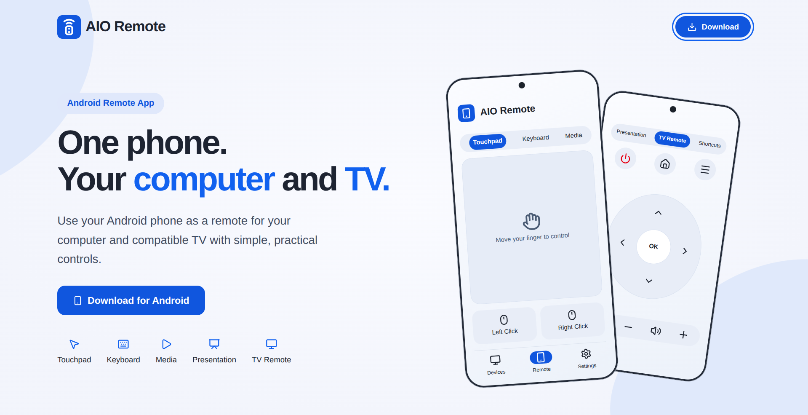

# AIO Remote

Use your Android phone as a touchpad, keyboard, and remote for compatible computers and TVs.

[][apk]

[Download the Android APK][apk]

## Build the Android APK

Install JDK 17 and Android SDK Platform 36.1. Set `JAVA_HOME` to the JDK and `ANDROID_HOME` to the Android SDK directory, then run this from the repository root:

```sh
./gradlew :app:assembleDebug
```

On Windows, run `gradlew.bat :app:assembleDebug`. The APK is written to `app/build/outputs/apk/debug/app-debug.apk`.

[apk]: https://github.com/kuldeeprajput-dev/AIO-remote/releases/download/v1.0.0/AioRemote.apk
